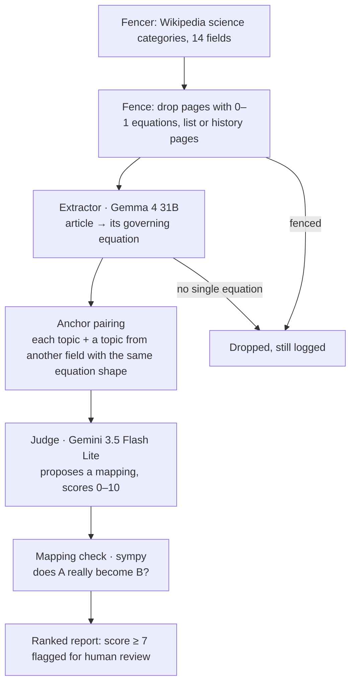

# Relations

> **This is a concept and an experiment, not a finished tool.** It has been run a few times on a small scale. It would need many more runs, better sources and a model of a different kind before it could claim to find anything new.

## The idea

In 1937 Claude Shannon noticed that Boolean algebra, which he had met in a philosophy course, and the relay circuits he was wiring as an engineer were the same mathematics. That one link gave us digital logic. Both pieces were already known; nobody had put them side by side.

Relations asks whether that kind of connection can be searched for on purpose. It takes topics from different fields, writes each one's governing equation in a common form, and looks for pairs that are secretly the same maths. An LLM proposes the links. A sympy checker, with no AI, proves or refutes each one.

## How it works



- **Fence:** only science, maths and engineering categories are fetched, so Shakespeare or Napoleon can never get in. A page also needs at least 2 equations.
- **Form check:** two topics are only paired if their equations have the same shape (same terms, same derivatives, same powers), and only across different fields.
- **Judge:** never says yes or no. It always proposes its best mapping (A's names → B's names) and a 0–10 score; pairs scoring 7 or more are flagged for a person to read.
- **Checker:** substitutes the mapping and tests whether A's equation becomes B's exactly. The model may argue; the checker decides.
- **Batches:** every 10 actions write their own report to `logs/`, failures included, and every run can be stopped and resumed.

## Results so far (Nov 2026)

**Benchmark (known answers):** 16 disguised pairs, 8 real links and 8 look-alike decoys, renamed into invented words. Result: 8/8 links found, 0/8 decoys accepted. This mostly shows the machinery works. The test is easy: the decoys differ in form, so the checker catches them, and the model knows this physics anyway, so disguising names hides little.

**Fencer on real Wikipedia data:** 550 pages checked → 200 kept → 128 with a usable equation → 19 cross-field pairs → 9 flagged by the judge.

| Pair | Score | Verdict |
| --- | --- | --- |
| Lotka–Volterra (predator–prey) ↔ SIR epidemic model | 8 | Real and exact (x → I, y → S, α → −γ, β → −β/N), but well known |
| Optimal forest rotation age ↔ logistic growth | 9 | Partial: only matches when the growth-fading term is set to 0 |
| Power laws, simple ratios, differences, products (6 pairs) | 7–9 | True but trivial |
| Leontief input–output ↔ cointegration | 8 | Not the same maths; the checker rejected it |

**Nothing found is new.** Every real link here is already known. That is expected: Wikipedia only contains documented science, so a link between two Wikipedia articles has very likely been made by someone already. What the run does show is that the pipeline rediscovered a genuine cross-field link (Lotka–Volterra ↔ SIR) on its own, without being told to look for it.

## Limitations

- **The models already know the science.** Gemma and Gemini were trained on much of the same knowledge we search through, so they can recognise famous links instead of discovering them. The experiment really wants a model that **can only read and write English and do basic maths**, with no stored knowledge of physics, biology or economics. Every link would then have to come from the text in front of it. No such model exists off the shelf; separating language ability from knowledge is an open research problem.
- **Only equations.** Links that live in logic, graphs, algorithms or analogies with no clean equation are invisible to the checker.
- **Many real equations are skipped.** Integrals, sums, matrices and abstract functions can't be parsed yet. Together with pages that had no single central equation, 72 of the 200 kept topics were lost.
- **Few pairs.** Real equations rarely share an exact form across fields: 128 topics gave 19 pairs, not the 100 hoped for.
- **Judge mappings can be wrong.** For Lotka–Volterra ↔ SIR it scored the pair highly but proposed a broken mapping; the correct one was checked by hand.
- **Checker loophole.** Mapping a constant to 0 deletes a term, so a pair can "verify" only in a degenerate special case (the forest ↔ logistic pair).
- **Small runs.** One benchmark and three fencer runs over the same 200 topics. Any conclusion needs many more runs.

## What would make it a real test

1. **A novelty check:** search the literature (Google Scholar, Semantic Scholar) for each flagged pair and label it *known* or *possibly new*.
2. **Fresher sources:** recent arXiv papers and small fields, where two results are unlikely to have been compared yet.
3. **Rare forms first:** rank coupled and non-linear equations above ratios and power laws.
4. **The checker searches for mappings itself** when the judge's mapping fails, and refuses mappings that set a constant to 0.
5. **A knowledge-free model:** see Limitations.
6. **Many more runs.**

## Setup

```bash
pip3 install -r requirements.txt
cp .env.example .env        # then paste your Gemini key into .env
```

## Commands

| What | Command | Needs the API? |
| --- | --- | --- |
| Key and models work | `python3 check_setup.py` | yes |
| Checker on plain benchmark pairs | `python3 tests/gate_step3.py` | no |
| Checker on disguised pairs | `python3 tests/gate_step4.py` | no |
| Benchmark: extractor + judge | `python3 run_benchmark.py` | yes |
| Fencer on Wikipedia | `python3 fencer.py` | yes |

Add `--no-pause` to run without stopping after each batch, `--max-batches N` to stop after N batches, and `--resume logs/<run>` to continue a saved run.

## Folders

| Folder / file | What it holds |
| --- | --- |
| `checker/` | parse, form check (equation shape), mapping check: no AI |
| `benchmark/` | 25 topics, 16 pairs (8 links, 8 decoys), plain and disguised |
| `fencer.py`, `wiki.py` | Wikipedia collection, fence, anchor pairing |
| `extractor.py`, `judge.py` | the two LLM roles |
| `llm.py`, `batching.py`, `config.py` | API client, batch reports, settings |
| `logs/` | every run's batch reports; each fencer run has a readable `pairs.md` |
| `docs/` | `BUILD_PLAN.md` and `ACTION_PLAN.md`, with the full history of decisions |
| `archive/` | earlier versions kept on purpose: the too-loose form check, the yes/no judge, the first README |
| `assets/` | flowchart source and screenshots |
