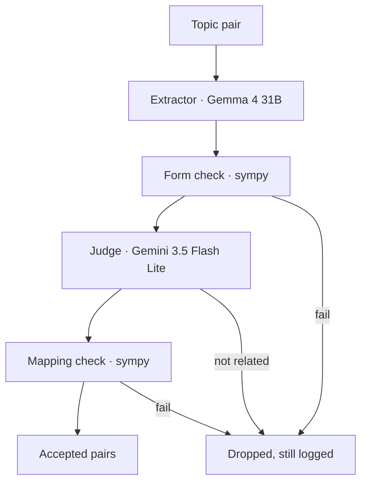

# Relations

Finds hidden connections between topics from different fields: two equations that are secretly the same maths (like a mass on a spring and an RLC circuit). An LLM proposes the link; a sympy checker, with no AI, decides whether it really holds.



Plan and progress: [docs/BUILD_PLAN.md](docs/BUILD_PLAN.md), [docs/ACTION_PLAN.md](docs/ACTION_PLAN.md).

## Setup

```bash
pip3 install -r requirements.txt
cp .env.example .env        # then paste your Gemini key into .env
```

## Run the gates

| Step | Command | Needs the API? |
| --- | --- | --- |
| 2: key and models work | `python3 check_setup.py` | yes |
| 3: checker on plain pairs | `python3 tests/gate_step3.py` | no |
| 4: checker on disguised pairs | `python3 tests/gate_step4.py` | no |
| 5: extractor + judge on the benchmark | `python3 run_benchmark.py` | yes |

Every run writes one report per batch of 10 actions (failures included) to `logs/`.

## Folders

| Folder / file | What it holds |
| --- | --- |
| `checker/` | parse, form check (signature), mapping check: no AI |
| `benchmark/` | 25 topics, 16 pairs (8 hidden links, 8 decoys), plain and disguised; `build_disguised.py` rebuilds the disguised set |
| `extractor.py`, `judge.py` | the two LLM roles |
| `llm.py`, `batching.py`, `config.py` | API client, batch reports, settings |
| `smoke_test/`, `feeder/` | steps 6 and 7 (not built yet) |
| `logs/` | every run's batch reports |
| `archive/` | old versions and dead ends, kept on purpose |
| `assets/` | flowchart source and screenshots |
