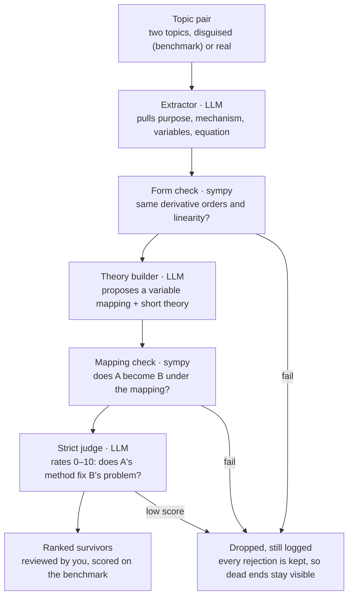

# Cross-Domain Connection Finder — Build Plan

Nov 17, 2026 · Varun V

## Verdict: build B, borrow A's test idea

Go with option B (a model plus an equation-checking tool), and replace option A's tiny model with disguised test pairs. That keeps A's real value, a known hidden answer to test against, without training anything.

|  | A: tiny model that knows little | B: model + equation checker |
| --- | --- | --- |
| Core idea | Train a small model on a few facts, one hidden connection it was never shown | A capable model reads two topics, proposes a link, a maths tool checks it |
| Can it reason? | No. Reasoning comes from broad training data, so a model taught 5 facts cannot talk or compare | Yes, it uses a full LLM |
| Does prior knowledge spoil the test? | No, that is its strength | Yes, unless the topics are disguised so it cannot recall the answer |
| Runs on an 8 GB MacBook Air? | Only toy-sized models, too weak for this | Yes, the model runs through an API |
| What it tells us | Whether a small network transfers rules between two systems, a narrower ML question | Whether the pipeline finds real structural links, the question we care about |

Why a "dumb" model is not needed in B: knowing more does not hurt, because the checker rejects anything that does not hold. Knowing too much only matters when testing, where the model might recall a famous link instead of finding it. Disguising the topics (fictional names, same maths) fixes that.

A is not dead, just later: a small transformer trained on two fictional, secretly identical rule systems is a good side experiment once B works.

## Architecture

**Only pairs that pass both maths checks reach the judge.**



The two sympy checks sit between the LLM steps, so the judge only ever sees pairs whose maths already lines up. Every rejection is still logged with its reason.

## Benchmark: known answers before unknown ones

The benchmark is about 16 topic pairs: 8 with a known hidden link, 8 decoys with none. Every topic is renamed into fictional vocabulary so the model cannot recall the answer.

**Hidden-link pairs (true positives to find)**, candidates:

| Pair | Shared structure |
| --- | --- |
| Mass–spring–damper vs series RLC circuit | Same second-order linear ODE |
| Heat conduction vs particle diffusion | Same diffusion equation |
| Boolean algebra vs relay switching networks | Same two-valued AND / OR algebra |
| Hooke's law spring vs capacitor charging | Linear storage element, energy = ½ × constant × quantity² |
| Pipe flow with friction vs current through a resistor | Linear flow driven by a potential difference |
| Truss member forces vs electrical network currents | Balance at every node, solved as a linear system |
| Radioactive decay vs RC discharge | Same first-order exponential decay |
| Pendulum (small angle) vs LC oscillator | Same simple harmonic equation |

**Decoy pairs:** 8 renamed topic pairs that look similar in words but differ in maths, for example a linear spring vs a quadratic drag force. These catch the judge saying yes to everything.

**How a pair is disguised:** every name, unit and variable is replaced ("spring" becomes "tessel", x becomes q7), but the equations keep their exact form.

**Scores**, where TP = true positives (real links found), FP = false positives (decoys wrongly accepted), FN = false negatives (real links missed):

```latex
\text{recall} = \frac{TP}{TP + FN} \qquad \text{precision} = \frac{TP}{TP + FP}
```

Recall says how many hidden links it found; precision says how much of what it claims is real. Target for moving on to real topics: recall ≥ 6/8 and at most 1 decoy accepted.

## The equation checker (sympy)

The checker is plain Python with sympy, no AI: it accepts a proposed link only if one topic's equation turns into the other's under the model's proposed variable mapping. The model may argue; the checker decides.

**Two checks, in order:**

1. **Form check (cheap filter).** Reduce each equation to a signature: which derivatives appear, their order, and whether terms are linear. Different signatures mean no link, so the pair is dropped without spending an LLM call.
2. **Mapping check (the real test).** The model proposes a dictionary such as {m → L, c → R, k → 1/C, x → q}. The checker substitutes it into equation A and tests whether the result equals equation B, allowing an overall constant factor.

**Worked example** (mass–spring–damper vs RLC). Symbols: m = mass (kg), c = damping coefficient (N·s/m), k = spring stiffness (N/m), x = displacement (m), F = applied force (N); L = inductance (H), R = resistance (Ω), C = capacitance (F), q = charge (C), V = applied voltage (V). A dot means a time derivative: ẋ = velocity, ẍ = acceleration.

```latex
m\ddot{x} + c\dot{x} + kx = F \qquad L\ddot{q} + R\dot{q} + \frac{1}{C}q = V
```

Both have the signature (2nd derivative, 1st derivative, value; all linear), so the form check passes. Under the mapping m → L, c → R, k → 1/C, x → q, F → V, equation A becomes equation B exactly, so the mapping check passes.

**In code**, the core test is a few lines:

```python
import sympy as sp

def same_under_mapping(eq_a, eq_b, mapping):
    lhs_a = (eq_a.lhs - eq_a.rhs).subs(mapping)
    lhs_b = eq_b.lhs - eq_b.rhs
    ratio = sp.simplify(lhs_a / lhs_b)
    return ratio.is_constant()   # equal up to a constant factor
```

The model must output equations as sympy-parsable strings. Anything that fails to parse counts as a rejection, not a crash.

## Phases, in build order

Six phases, each small enough for one or two sessions around exams. Each ends in something that runs.

1. **Setup.** Python project, sympy, one LLM API key, a JSONL log file. Done when a script sends a prompt and saves the reply.
2. **Checker first.** Build the form check and mapping check, and test them by hand on the 8 known pairs written in normal names. Done when all 8 pass and the 8 decoys fail, with no AI involved.
3. **Benchmark set.** Write the 16 disguised pairs as data files: description text, equations, and the hidden answer stored separately. Done when the files load and the checker still agrees on the disguised versions.
4. **Extractor.** An LLM call turns a topic's text into JSON with purpose, mechanism, variables and governing equation. Done when it pulls the right equation from most disguised descriptions.
5. **Theory builder + judge.** The model proposes a mapping and a one-paragraph theory for each pair that passes the form check; the checker verifies it; a strict judge rates it 0–10. Every attempt is logged, dropped ones included. Done when the benchmark run prints recall and precision.
6. **Real topics.** Pull pages on your own course topics (mechanics, aero, electronics), run the same pipeline, and review the top-rated survivors by hand.

Optional later: option A's tiny-transformer experiment as a side study.

## Infrastructure, feeder fence and the 100-example run

The LLM runs through the Gemini API, the Azure credit runs the always-on parts, and the first real run is capped at 100 candidate pairs that you review by hand.

**Where each part runs**

| Part | Runs on | Why |
| --- | --- | --- |
| LLM (extractor, judge) | Gemini API, Flash-Lite model | Azure for Students blocks GPU VMs ([Microsoft Q&A](https://learn.microsoft.com/en-us/answers/questions/2157302/clarification-on-gpu-access-after-upgrading-azure)); a T4 GPU VM would cost about $384 a month anyway ([Azure prices](https://www.azurespeed.com/AzureVmPricing/Standard_NC4as_T4_v3)) |
| Feeder, sympy checker, database, logs | Small burstable Azure VM (B-series), $100 student credit | Student subscriptions allow small B- or D-series VMs within a 4 vCPU quota ([Microsoft Tech Community](https://techcommunity.microsoft.com/discussions/microsoft-learn-for-educators/sku-quota-and-policy-restrictions-on-azure-for-students-and-free-subscriptions/4525160)) |

**Memory and grounding.** A model's knowledge cannot be wiped without losing its language. Instead, every claim must cite a retrieved passage ID, and the checker rejects claims that cite nothing.

**Gemini calls.** Free-tier limits are per project and shown only in the AI Studio console, so check your key's limits before the run. Each request carries 10–20 pairs and returns a JSON list: pair_id, related (true/false), score (0–10), and a reason under 15 words. 100 pairs is about 5–10 requests.

**Smoke test before any real data.** One text file of invented maths: 30–50 made-up definitions and theorems, 2 hidden connections, and a few decoys that look related but are not. Pass = both connections found, no decoy accepted.

**Feeder fence, cheapest layer first**

1. **Source fence.** Fetch only from arXiv categories (maths, physics, quantitative biology, economics, electrical engineering, CS) and Wikipedia science and maths categories. No open-web scraping.
2. **Formality score.** Count equations per page (LaTeX blocks, = signs between symbols); below a threshold, drop the page. No LLM call.
3. **Pair fence.** Two topics are paired only if their equation signatures match in the form check, and only if they come from different fields. A topic with no equation can never form a pair.

**The 100-example run.** The feeder fills a pool, the form check produces candidate pairs, and the first 100 that pass go to Gemini in batches. You review all 100 with their reasons, then decide what to change before any longer run. This replaces the month-long 24/7 run.

## Risks: where it is likely to break

The biggest risk is that the checker only sees links that are written as equations. Shannon's link (Boolean algebra) is logic, not an ODE.

| Risk | What it looks like | Fallback |
| --- | --- | --- |
| Non-equation links | Logic, graphs or analogies with no clean equation slip past the checker | Add a second checker type later, such as truth tables for logic; until then, log these as unverified |
| Disguise leaks | Fictional names still give it away ("tessel oscillates under restoring pull") | Have a second LLM call try to guess the original topic; if it can, rewrite the description |
| Extractor errors | Wrong equation pulled from the text, so a true link is rejected | Check extractor output against the stored equations in phase 4 before blaming the matcher |
| Lenient judge | Rates every theory 7/10 | The judge only sees pairs the checker passed; score precision on the decoys |
| API cost and rate limits | Many calls per pair | The form check drops most pairs before any LLM call; start with a free tier |
| Real topics are messy | Course material mixes several equations per topic | Extract one equation per sub-topic, not per page |

## Open decisions before coding

- [ ] Which LLM API? Gemini's free tier is the default, since an 8 GB laptop cannot run a capable local model.
- [ ] Where does the code live: a new repo (for example connection-finder), with the 3am-thoughts entry linking to it?
- [ ] Which 8 hidden pairs exactly? The table above is a starting list; swap in any you know better.
- [ ] How much time per week until the exams are over?
